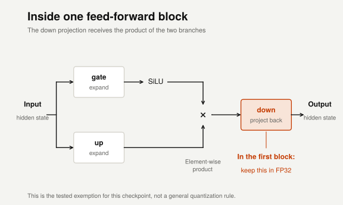
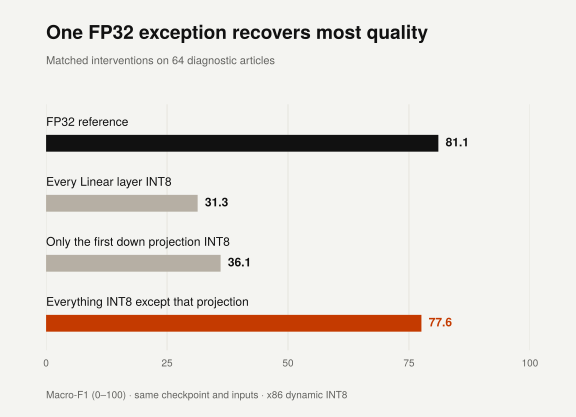

{::options smart_quotes="apos,apos,ldquo,rdquo" /}

My [last two posts][previous] made the case for fine-tuned encoders when the job is
classification. The next obvious question is what happens once you have a model
that works: can you make it smaller and faster on CPU without giving up much of
its classification quality?

I started with dynamic INT8 quantization because it reuses the trained checkpoint
while reducing the precision of its Linear operations - offering a way to lower
inference cost without training a replacement. I expected to measure that
tradeoff but instead, my fine-tuned UltraBERT went from **77 to 29 macro-F1**...
It still returned labels, but most of them were now concentrated in two classes.

This post follows how I tracked that failure to one Linear projection, why some
apparently useful measurements pointed in the wrong direction, and how leaving
that projection in FP32 recovered most of the lost quality. Then comes the
serving check: whether a recovered score also meant the model behaved
consistently when I changed how requests were batched.

The practical question throughout is **what evidence would make this compressed
model a useful deployment candidate?** Finding a smaller artifact is easy enough.
I wanted to establish where its predictions broke, whether a targeted exception
could help, and what remained different after the score looked healthy again.

## Finding which model component breaks under INT8

The task is newsletter-section classification: predict a section from an article
summary. As in the previous posts, this is my dataset and my label mapping, which
means the target includes editorial conventions as well as topics. I used a
fresh, text-deduplicated split here, so these scores aren't a continuation of the
earlier leaderboard.[^methods]

I fine-tuned [UltraBERT-150M][ultrabert], then converted its Linear modules using
PyTorch's eager dynamic INT8 path. Embeddings and normalization stayed FP32. The
implementation matters: the results below concern Torch 2.8's x86 path, rather
than every way of running an encoder in INT8.

Before looking inside the network, I checked whether the failure came from
saving and restoring the converted model. A quantized artifact has to reconstruct
the right module types and packed weights, so a reload bug would have been a
plausible explanation for a large quality drop. Reloading reproduced the
pre-export predictions, which ruled out that explanation for this failure.
Changing batch size and removing padding didn't restore quality either.

Converting every Linear module at once had changed too much to give me a useful
lead. I therefore moved to a fixed diagnostic subset of 64 validation articles
and quantized groups independently, always starting from the same FP32
checkpoint. The idea was to find a group that could reproduce the collapse while
leaving the rest of the model alone, before spending time on individual layers.

Attention-only quantization stayed close to FP32, whereas quantizing the
feed-forward networks (FFNs) caused a large drop. Keeping the classifier in FP32 didn't
rescue the converted backbone either. The FFNs were a useful boundary to
investigate, because their quantization was sufficient to reproduce the problem
without quantizing attention or the classifier.

## Testing weight rounding inside the FFN

UltraBERT's FFN has two branches: one applies a SiLU activation to the gate
projection, their outputs are multiplied element by element, and a down
projection maps the product back to the hidden width.



```python
hidden = silu(gate_proj(x)) * up_proj(x)
output = down_proj(hidden)
```

Those are all Linear projections, but they act on different representations. The
gate and up projections receive the incoming hidden state; the down projection
receives the product of the transformed branches. That distinction suggested a
more useful experiment than treating every operation in the FFN as equally
sensitive.

Quantizing the gate and up projections left every predicted class unchanged on
the diagnostic subset. Quantizing the down projections reproduced the failure.
This located a sensitive part of the computation, although it didn't establish
that the multiplication, or any particular feature of its output, caused the
problem.

I then tested a simpler explanation: perhaps rounding the FFN weights was enough
to damage the model this badly. I rounded them to their INT8 values, dequantized
them, and ran the operations in FP32, keeping the approximation in the weights
while removing the dynamic INT8 execution path. Quality stayed close to the
reference.

The distinction matters because [dynamic quantization][pytorch] quantizes
activations during execution as well as pre-quantizing weights. An operation can
accept and return floating-point tensors while doing different arithmetic
internally from an FP32 operation with rounded weights. Looking only at the
stored weight values would miss that part of the change.

The control showed that weight rounding alone was insufficient to reproduce the
collapse. Runtime quantization and kernel execution contributed substantially, but
this experiment doesn't distinguish activation quantization from backend
arithmetic effects. It narrowed the question without answering the precise
numerical cause.

## Comparing tensor error with prediction changes

Another reasonable approach was to measure how much error each quantized FFN
operator introduced and investigate the worst one first. To make that comparison
useful, I gave each operator the input it received in the FP32 model, so its
measurement wouldn't already include errors propagated from quantized operators
upstream.

The largest local error was in an **up projection** much later in the network.
Yet quantizing all the up projections had changed no class predictions on the
diagnostic subset.

That result made me cautious about using tensor error as a ranking of what to
fix. An intermediate perturbation still has to pass through the rest of the
network, and its size doesn't tell you whether it will change the ordering of
the final class scores. A classifier can tolerate a sizeable numerical change
while choosing the same label; another perturbation can move a decision across a
class boundary. The local measurement and the end-to-end intervention answer
different questions.

So I also quantized entire FFN blocks one at a time. Quantizing the first block
alone caused a large drop, while individually quantizing the remaining blocks
barely changed the score. I now had two clues from independent intervention
families: the down-projection group was sensitive, and the first FFN block was
sensitive.

Their intersection was an obvious candidate, but it still needed a direct test:

```text
ultrabert.layers.0.mlp.down_proj
```

## Recovering quality with one FP32 projection

There were two useful experiments to run on that projection. Quantizing it on
its own would test whether its conversion was sufficient to cause severe
degradation, without accumulating quantization errors across the network.
Preserving it in FP32 while quantizing the other Linear modules would test
whether the rest of the low-precision model could still work around that
exception.

Both interventions supported the hypothesis. Quantizing just the first down
projection caused a large drop; keeping it in FP32 while quantizing the other
168 Linear modules recovered most of the lost quality.



*These comparisons use the same 64 diagnostic articles, with each variant
starting from the same FP32 checkpoint.*

This was a more useful result than knowing which tensor had the largest error:
it connected a localized change to both a failure and a corresponding recovery.
It wasn't a complete recovery, and it didn't establish that this was the only
sensitive operation, but it gave me a specific recipe to check more broadly.

## Checking whether batch size changes the predictions

The small diagnostic subset had now guided several choices, so its recovered
score couldn't also serve as independent confirmation of those choices. I
froze the exemption and evaluated it on the remaining validation articles, which
hadn't been used for the quantization diagnosis. The original checkpoint
selection had used full validation, so this still wasn't an untouched holdout.

Macro-F1 stayed within about a point of FP32 across the batching and padding
policies I checked. That was encouraging, but it left another question: whether
the model was making similar decisions on individual articles, or simply getting
a similar number of decisions right.

That difference matters for serving. Batch size is often an infrastructure
choice made to improve throughput, and a classifier feeding a routing system
could send the same request down a different path if its label changed with
that choice. I wanted to compare the decisions directly instead of assuming
that a nearby aggregate score implied nearby behavior.

At fixed padding, switching from a batch of 16 to processing each article alone
changed **67 of 1,156 INT8 decisions**. FP32 changed none. The aggregate score
actually improved slightly: processing alone corrected 33 mistakes against the
dataset labels, but introduced 28 others. The remaining changes were between two
labels that both disagreed with the dataset.

This is why the higher score wasn't enough to settle the deployment question.
It summarized a mixture of corrections and regressions, while the serving-policy
change determined which individual requests received those different answers.

Here is the first changed example in validation order, a summary about GitHub
Copilot. In a batch it reads as Headlines & News; alone it becomes Guides &
Resources. The summary, checkpoint and padding length are the same.

<div class="prediction-explorer-inline">
  <iframe id="ultrabert-predictions" class="prediction-explorer-frame" src="{{ '/experiments/ultrabert-batching/' | relative_url }}?embed=1" title="Compare the same article's predictions in a batch and alone" loading="lazy" height="1100" hidden></iframe>
  <noscript></noscript>
</div>
<script src="{{ '/assets/js/ultrabert-embed.js' | relative_url }}" defer></script>

Try another article, switch the processing policy, or compare with FP32. The bars
show normalized model scores, not calibrated confidence.
[Open the full explorer →](/experiments/ultrabert-batching/)


The experiment doesn't isolate a particular batch companion as the cause: moving
from a batch to an individual forward pass changes the shape of the computation
too. It does establish that this recipe's decisions depend on the tested
batching policy. The unchanged FP32 decisions provide a control for the same
inputs, while the INT8 comparison exposes behavior that the aggregate score
concealed.

A save/reload check couldn't have answered that question. It verifies that the
saved model reproduces its own behavior under a given policy, which is useful,
but doesn't establish that the model behaves the same under another one.

## Measuring the size and latency tradeoff

After the failure investigation, I still needed to answer the original question:
what did the exemption actually buy in size, latency and quality?

On the final paired CPU comparison, the deployment artifact was **about 55%
smaller** than FP32, with **23% lower median latency** at actual input length.
The observed macro-F1 cost under that policy was less than a point. That made it
a useful candidate under these measurements, although its remaining decision
sensitivity still needed to be considered for the intended application.[^measurement]

The size reduction and speed improvement were quite different. Artifact size
measures what is stored, while latency includes the work of executing the model;
these timings don't isolate individual kernel costs or explain exactly where the
runtime went. Halving the file size doesn't imply halving the forward-pass time.

Padding was a bigger speed lever in this run: removing fixed-length padding more
than halved the FP32 median latency. Comparing padded FP32 with unpadded INT8
would have credited quantization for an improvement that also came from changing
how much padded input the model processed. Keeping the serving policy matched
made the smaller quantization gain easier to interpret.

I would also benchmark a smaller FP32 model before adopting the exemption. The
small Ettin baseline was much faster in the original comparison, at a quality
cost. Whether that tradeoff is acceptable depends on the task, and compression
should earn the extra moving parts it introduces.

## What to check before deploying a quantized model

The investigation started as a compression experiment, but the useful result was
a way to judge the candidate that came out of it. The targeted interventions
showed where this conversion damaged the checkpoint and whether an exception
could recover quality. The serving comparison then showed why that recovery had
to be evaluated at the level of individual decisions as well as an overall
score.

I added the conversion, exemption and reload checks to a [standalone bert-squeeze
example][example], which you can use with a public demo checkpoint or your own
classifier. The measured UltraBERT checkpoint isn't public yet, so it doesn't
currently offer a public reproduction of these exact scores. The projection I
preserved is also a finding for this checkpoint, rather than a default I'd copy
to another encoder.

I still don't have the precise numerical explanation for its sensitivity. What I
would carry into the next deployment is the experimental approach: isolate a
change, test whether the proposed fix really recovers the behavior you care
about, then measure the result under the policy you intend to serve. A smaller
model with a recovered benchmark score is a candidate to validate, and the
individual predictions are part of that validation.

[^methods]: The [methods and recorded results](/experiments/ultrabert-batching/evidence/)
    collect the split, label mapping, ablations and runtime pins. The newsletter
    taxonomy has ambiguous mappings, and source-article overlap remains after
    text deduplication. This is a numerical case study on one checkpoint, not
    evidence of generalization to future newsletters. The rescued recipe wasn't
    evaluated on test data.

[^measurement]: The paired CPU measurements used the same worker, inputs and
    thread settings. They don't establish production tail behavior or runtime
    memory use. A fresh-runtime check matched the final validation scores but
    differed on two diagnostic INT8 scores and timings; both observations are
    retained in the methods page. Their cause remains unresolved.

[previous]: /zero-shot-plateau/
[ultrabert]: https://huggingface.co/dmis-lab/UltraBERT-150M
[pytorch]: https://pytorch.org/blog/quantization-in-practice/
[example]: https://github.com/JulesBelveze/bert-squeeze/blob/539aeaed5fa96789c3c1e7c3c6dcd505e9adba79/examples/selective_quantization/README.md
