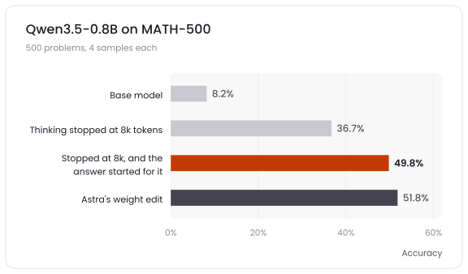
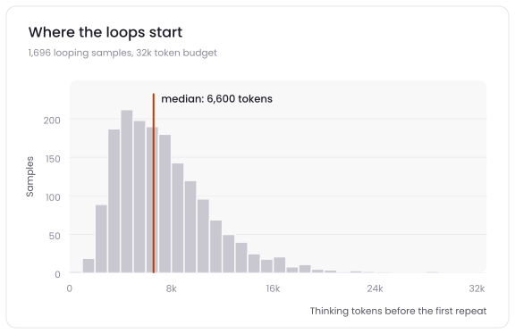
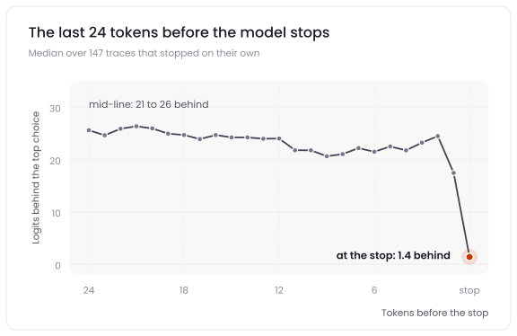
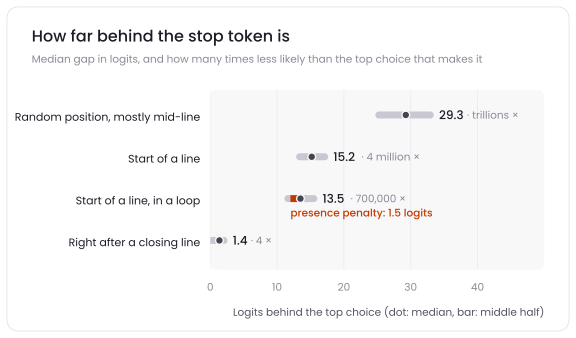
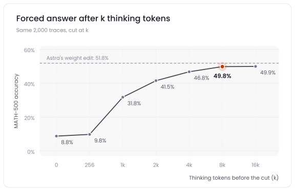

{::options smart_quotes="apos,apos,ldquo,rdquo" /}

This is Qwen3.5-0.8B, about 4,000 tokens on an algebra problem.

```text
* $45 + 2 = 47$.
* $47 - 5 = 42$.
* $42 + 5 = 47$.
* Okay, I am confident in 47.

* Wait, I should check if there is any hidden trick.
* Maybe the expression is $a \star b = 9a + 2b - ab + 5$.
* Wait, let me check if the term is $-ab$ or $+ab$.
    [...]
* Wait, let me check if the term is $-ab$ or $+ab$.
* Wait, let me check if the term is $-ab$ or $+ab$.
```

And then it writes that last line again and again. For 28,000 more tokens,
until the budget runs out. Since it never gives an answer it actually gets marked wrong. Even though it
had 47 the whole time.

Why care about one small model stuck on one algebra problem? Because of a
result you may have seen two weeks ago. A group at MIT CSAIL published [Sparks of Weight-Space Programming][logs]. 
They gave GPT-6 Astra direct access to this "little" model's weights and let it experiment for 50
rounds. Astra ended up changing 131,072 weights (0.016% of the model),
and MATH-500 accuracy jumped from 7.9% to 48.1%.

Spoiler alert: most of the 40 points between 7.9% and 48.1% are caused by a stopping
problem. The model often has its answer within a few thousand tokens and then
can't end its own thinking. If you end it yourself and write the first few words
of the answer for it, it scores 49.8%, without touching weights. That's about
where the edit lands. The trick only works because every answer here goes in a
"box", but we'll get to that.



*The first three rows are all cut from the same 2,000 traces (500 problems, 4
samples each). The last row is the authors' edited checkpoint, run through the
same pipeline. I get 51.8% there, a bit above the 48.1% they report.*

A bit of context if you haven't used these models. In thinking mode the
model writes a scratchpad first, then emits a special `</think>` token, then
writes its answer. Only a final `\boxed{}` answer counts.

Astra's own report is pretty upfront about what the edit fixes. Of the 579
samples it rescued on its practice problems, 576 had simply run out of budget
before. So it's an edit that stops the model looping.

One thing before going further. With thinking turned off the model already gets
43 to 50%. People on [the audit thread][issue4] found that before I
did. But then you have a thinking model you can't let
think, and I wanted to understand why thinking mode breaks.

So here are a few questions. When does the loop start? Why can't the model
get out on its own? Can you get it out without touching the weights? And what
did the edit do that worked?

## 152 samples finished, and all 152 were right

First thing I did was to rerun the base model exactly the way the authors did, with
a 32,768-token budget.[^protocol] I got 8.2% accuracy, with 92.4% of samples
running out of budget, which is right where the authors' numbers are (they
report 7.9% and 93.0%).

Only 152 of the 2,000 samples finished on their
own, and all were correct. (The other 11 correct ones ran out of budget
but had boxed an answer inside their thinking, which the grader accepts.) So the model isn't getting 92% of
MATH-500 wrong, it basically isn't answering 92% of it.

I wrote a dumb detector to understand what is it doing with all those tokens? A sample
is looping if, from some point until the end, most of its 12-token windows are
exact copies of an earlier one. 1,696 of the 1,848 samples that ran out of
budget qualify. I went and looked at the ones it didn't flag, and they're stuck too:
longer cycles my detector misses, or counting upwards forever.



The typical loop starts 6,600 tokens in. After that the sample burns another
26,000 tokens on the same handful of lines. So when you see "8% on MATH-500",
you're looking at two things multiplied together: can it solve the problem, and
can it finish.

## So why doesn't it just stop?

I needed a way to measure "how close is it to stopping", and found, imho, a
clean one. At every step the model gives each token in its vocabulary a score,
called a logit, and the probability of a token grows as *e* to the power of that
score. Being one logit behind the top choice makes you about 2.7 times less
likely. Being fifteen behind makes you about 3 million times less likely.

Stopping means emitting `</think>`. So I can ask, at any position, how many
logits `</think>` is behind the model's top choice. I'll call that the gap. I
took 147 of the traces that stopped on their own and read the gap at each of
the 24 positions before the stop.



Honestly, I kinda expected a ramp. I thought the stop token would slowly get more
likely as the reasoning wrapped up. That's not what happens at all. Every one of
the 147 stops comes right after a line break, and the line before it is nearly
always the model telling itself it's finished. Stuff like "Okay, done
thinking." or "Ready to write." In the middle of a line, stopping isn't even on
the table. That's the flat part of the chart, somewhere between 21 and 26 logits behind. Even at
the start of an ordinary line the stop token is still about 15 behind (you'll
see that one on the next chart). Right after one of those closing lines, it's
1.4 behind - the cliff at the right edge of the chart.

So then I got curious about what makes a line a closing one. I thought it'd be the
wording, but a line that says "done" or "ready" only makes the stop likely about
one time in seven. It depends on where the line sits. In the first half of a
trace almost no line opens a real chance to stop. Right at the end, about one in
five does. The model has to wind down first.

I also wondered if this was just a quirk of this one small model, so I ran the
same thing on Qwen3-1.7B. It finishes 94% of the time, and it has the same
cliff, only sharper.

Which brings me back to the 47 trace. I was sure "Okay, I am confident in 47."
was a missed chance to stop. So I checked, and I was wrong (again): right after
that line the stop token is still 15.6 logits behind, same as any other line.
The model wasn't close. Same story on the others: of 120 looping traces I looked
at, 117 never had a single real chance to stop before the loop began.

## Okay, but can't you just penalize repetition?

That was my next thought. Let's start with why it repeats in the first
place. Astra's logs have a lead here. In layers 15 and 19 there's an attention
head that looks back at the last time the current text showed up, and at what
came right after it. Astra only flagged them as candidates, but you can see the
effect without them. In my traces, the model gives a brand new line a
probability of about 0.68 per token. The same line a second time, 0.85. By the
tenth time, 0.98. Every copy makes the next one more certain. (If you want to go deeper [Pipis et al.][pipis] look at looping
in reasoning models more generally).

The evaluation already had a presence penalty of 1.5 turned on. That subtracts
1.5 from the logit of any token the model has already produced. It's flat: same
discount on the 500th repeat as on the second. So put that 1.5 next to the gaps.



Inside a loop, at the start of a line, `</think>` is 13.5 logits behind. The
penalty gets that down to about 12, which still makes it more than a hundred
thousand times less likely than the top choice. I checked 4,800 positions inside
loops, and the penalty didn't change the top choice at a single one. And it's
worse than that. The sampling settings throw away unlikely tokens before
picking (top-k 20, top-p 0.95), so at every one of those positions `</think>`
couldn't be sampled at all. I tried penalties that grow with each repeat as
well, and they don't save it either.[^penalties]

## If it won't stop, stop it yourself

At this point the model clearly isn't going to make the decision, so I made it
for it. I came across *budget forcing*, from the [s1 paper][s1]. They
describe it as appending the end-of-thinking token "and optionally 'Final
Answer:'" once you hit a token budget. Turns out that on this model the
"optionally" part matters a lot.

I tried the simple version first. Append `</think>` after 8,192 thinking tokens
and give the model 4,096 tokens to answer. That gets 36.7%. Better, but two
thirds of the time it uses up all 4,096 tokens and never gives a boxed answer.
I went and read a few to see why, and it's kind of funny: it starts over. For example, on
the 47 problem:

```text
To find the value of $5 \star 1$, we need to substitute the values $a = 5$
and $b = 1$ into the given expression for the operation $\star$.
```

So closing the tag ends the thinking, but the model still doesn't commit to what
it already found. And a fresh attempt can loop all over again.

The second version writes the first words of the answer too:

```python
prompt_ids = prompt + thinking[:8192] + tok("\n</think>\n\nThe final answer is $\\boxed{")
answer = generate(prompt_ids, max_tokens=32, temperature=0)
```

That one gets **49.8%**, with a 95% interval of 46.0 to 53.6. Compared with the
base model, 300 of the 500 problems get solved more often and 3 less
often.[^prefix] My guess at why it works is that after "The final answer is",
the most likely thing to write is a value the model has already written several
times. So the copying habit that causes the loop is probably what helps here.

## Is it just guessing, though?

To check, I changed how much thinking the model gets before I force the answer.



With zero thinking, forcing an answer gets 8.8%. So no, it can't just guess.
Most of the accuracy shows up between 256 and 4,000 tokens, there are 3 more
points by 8k, and then nothing. Which is right about where the loops start.

I also went looking for the answer in the scratchpad directly. I dropped the
half of the problems with one or two-digit answers, since those numbers show up
everywhere. On the rest, when forcing gave the right answer, that answer was
already written somewhere in the first 8k tokens 67% of the time. When forcing
gave a wrong answer, it was 14%. And it barely hurts the samples that were fine: of the 152
that would have finished on their own, forcing at 8k breaks 3.

## How this stacks up against the edit

On MATH-500 they land in the same place, with the edit a little ahead. I ran the
edited checkpoint through my own pipeline and got 51.8%. Forcing on the base
model is 2.0 points behind that, with an interval that runs from 4.5 behind to
0.4 ahead. Also, they don't add up, so they're fixing the same
failures: if I force an answer on the edited model I get 53.0%, which is inside
the noise.

Back to turning thinking off. Neither of these is the cheapest way to get the
score. With thinking off, people on the thread measured 43 to 50% depending on
the settings, and the run closest to this setup got 43 to 44% at about 3,700
tokens per sample. If the score is all you care about, don't turn thinking on.

Forcing does show that thinking mode can be rescued, as long as you make the
model commit and don't only cut it off. But it has limits the edit doesn't have.
You need control of the decoder and you need to know how an answer starts.
Opening the box also means there's always something to grade, while about 8% of
the edited model's samples finish without a boxed answer. The edit is just
weights, and the authors report gains on benchmarks like IFEval, where there's
no boxed answer to start. And all of this is one model on one
benchmark.

## So what did Astra's edit do?

This is the cool part. The model's state at each position is a vector
of 1,024 numbers, and a *direction* is just a unit vector `u` in that space.
Here `u` is whatever separates "the model is repeating itself" from "the model
is making progress". The edit takes 64 neurons in each of two layers and makes
them push against it. Call `W` the matrix where each column is what one neuron
adds to the state, and the whole edit is one line:

```python
W[:, cols] -= 6 * torch.outer(u, u @ W[:, cols])
```

Subtract once and you remove what those neurons write along `u`. Subtract six
times and you're left with 1 − 6 = −5 times the original, so they now push the
other way, five times harder. 64 neurons × 1,024 numbers × 2 layers gives you
the 131,072 weights, and the layers are 15 and 19, the same two layers as those
candidate copying heads. I rebuilt the edited weights from that single line and matched theirs up
to rounding.

The edit doesn't make stopping more likely, by the way. Astra's logs show
`</think>` staying just as unlikely at moments where stopping would be
premature. As far as I can tell from the logs, it makes the repeated line less
attractive, so the model keeps reasoning until it winds down by itself.

I figured finding `u` must have eaten most of the 50 rounds. Nope, Astra had it
on round three. It wrote eight short texts, four pairs that share a problem and
an opening. In each pair, one continues normally and the other repeats a
sentence three times. `u` is the average state at the end of each text,
repetitive minus normal, read from the running state that every layer adds to.
I ran that same recipe and got Astra's direction back with a cosine above
0.9999. The other rounds went into how hard to push, controls, and checking on
held-out problems.

When I'd tried to find the direction myself, before reading how Astra did it, I
got nowhere near. It took me a while to see why. I was reading at the output of
the feed-forward block, and the place to read is the running state. My data was
fine, I was looking in the wrong place.[^probe]

## Takeaways

If a thinking model runs out of budget, end the thinking and start the answer
for it. Here that was the difference between 36.7% and 49.8%, and it's
one line of code.

Whenever I see an accuracy measured under a token cap, I'm going to look for how
many samples finished. The authors put that column next to every score, and
that's what made this whole thing checkable.

And before I reach for a sampler setting again, I'll measure the gap it's
supposed to close. A flat 1.5 against 13.5 logits was never going to work.

A thinking model stops once it has wound down and told itself it's done. This
one doesn't get there on 92% of samples. What I still
don't know is why. The 1.7B model gets there on almost every problem, so the
winding down gets learned somewhere between the two, and I'd love to know where.

---

The traces, the per-sample results for every cut, and the code are in [this
repo][repo]. Thanks to Carlos Toledo, HedonismJesse, buzzedaldrinx86 and the
others on [the audit thread][issue4], and to the authors for releasing enough to
be checked.

[^protocol]: vLLM 0.33.0, the official weights at the revision the post used,
    temperature 0.6, top-p 0.95, top-k 20, presence penalty 1.5, seed 0, graded
    with math-verify 0.9.0 through the authors' own script. The model samples left
    to right, so the first *k* tokens of a seeded 32k sample are distributed
    like a *k*-token run, which is why every cut comes from the same 2,000
    traces. Intervals
    are bootstrap intervals over problems and don't include run-to-run variance.

[^penalties]: On 100 problems, adding a repetition penalty of 1.1 took accuracy
    from 4% to 20%, with 79% of samples still running out of budget. A frequency
    penalty of 0.2 ended the loops and the reasoning with them: the model soon
    runs out of usable tokens and scores 0.5%. Loops aren't strictly permanent
    either. Of roughly 1,700 samples that spent 4,000 tokens or more in one, 3
    got out after a single token came out differently.

[^prefix]: That's with greedy decoding for the answer. With the original
    sampling settings the same prefix gets 48.2%. A plain "Final Answer:" prefix
    gets 41 to 42%, and half the time the model then answers without a box.

[^probe]: On the model's natural loops, the same kind of difference has a
    cosine of 0.4 with Astra's direction when I read it at the output of the
    feed-forward block, and 0.7 when I read it from the running state. Astra's
    own eight texts, read at the feed-forward output, also give 0.4. I also
    trained a logistic probe to tell first occurrences from repeats. Its
    direction has a cosine of 0.07 and 0.10 with Astra's in the two layers. [Marks and Tegmark][marks] saw
    the same thing: difference-of-means directions have more causal effect than
    probe directions. As an edit it does nothing:
    96% of samples still run out of budget on a 25-problem check, against 80%
    for my feed-forward direction and 28% for Astra's.

[logs]: https://github.com/RikiyaT/lm_understand-logs
[issue4]: https://github.com/RikiyaT/lm_understand-logs/issues/4
[s1]: https://arxiv.org/abs/2501.19393
[pipis]: https://arxiv.org/abs/2512.12895
[marks]: https://arxiv.org/abs/2310.06824
[repo]: https://github.com/JulesBelveze/the-model-had-the-answer
